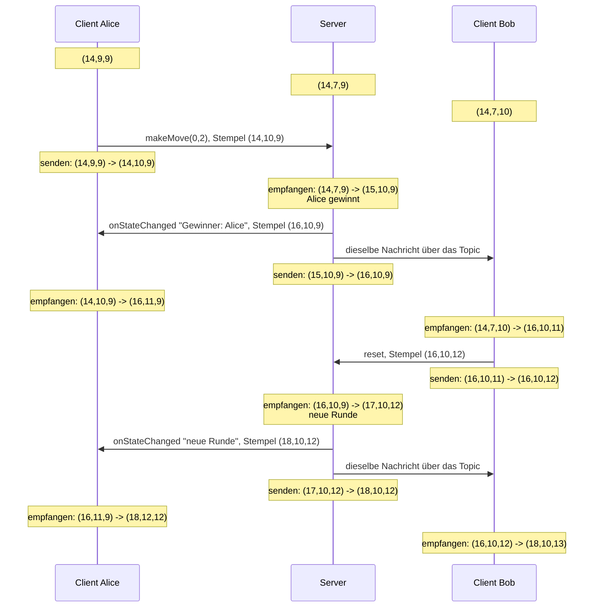
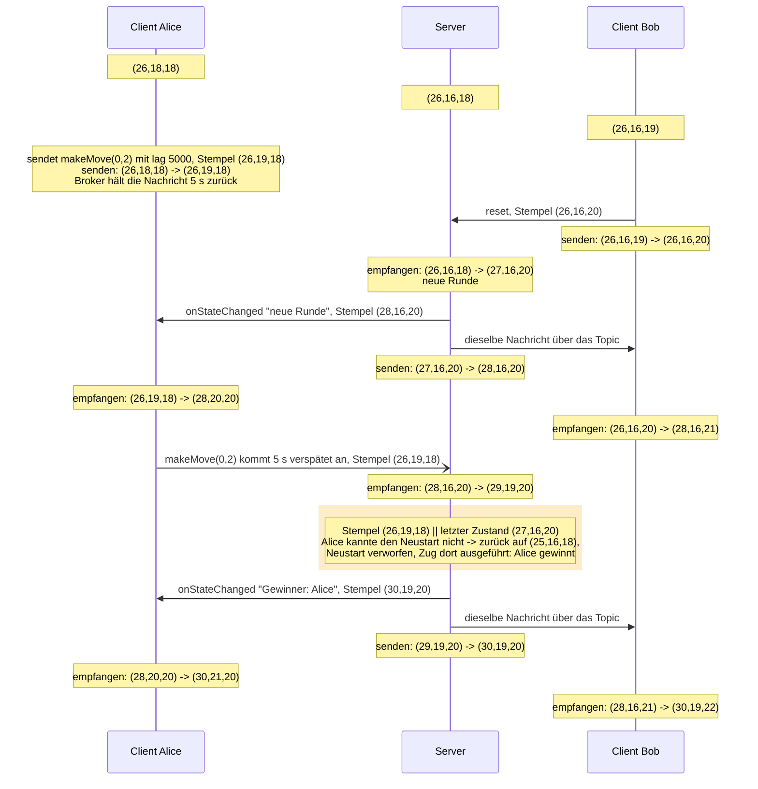

# Tic-Tac-Toe über ActiveMQ/JMS (AI-VSP Praktikum 2, WiSe 2026/27)

Java 25, Maven, Gson, ActiveMQ 5.15.12 (JMS 1.1). Praktikum 1 (JSON-RPC über TCP) steht auf dem Branch `main`.

Aus Praktikum 1 bleiben Spiellogik (`Game`), DTOs, Contract-Interfaces und die Trennung in Stubs und Skeletons. Getauscht
wird der Transport: Statt einer TCP-Verbindung laufen alle Aufrufe als Nachrichten über den Message-Broker.
Neu sind Vektoruhren an jeder Nachricht und das Zurückspulen auf dem Server bei verzögerten Nachrichten.

---

## Client-Server-Contract
```java
interface GameService {                       // Client -> Server: Nachricht in die Queue, Client wartet nicht
    void join(Player player);
    void makeMove(Move move);
    void reset();
    void leave(Player player);
}
interface GameListener {                      // Server -> Client
    void onStateChanged(GameState state);     // über das Topic an alle Clients
    void onError(String message);             // nur an den Client, dessen Aufruf gescheitert ist
}
```
- Jede Methode hat höchstens ein Argument; der Body einer Nachricht ist genau dieses DTO.
- Alle Methoden sind `void`. Den neuen Zustand erfahren alle über `onStateChanged`, einen Fehler nur der Absender über
  `onError`. Es gibt also für jede Information genau einen Kanal.
- DTOs: Client -> Server `Player`, `Move` (enthält `Player`); Server -> Client `GameState` (enthält `Board`, `Player`).

Vereinfachungen nach den Hinweisen des Profs zu Praktikum 2:

| Hinweis | Vorher (Praktikum 1, erste Fassung) | Jetzt |
|---|---|---|
| Ein Argument, keine doppelten Kanäle | Beitritt kam dreifach an (Rückgabe von `join`, `onPlayerJoined`, `onStateChanged`), der Zustand nach einem Zug doppelt (Rückgabe von `makeMove`, `onStateChanged`), dazu `getState()` | Zustand nur über `onStateChanged(GameState)` |
| DTO-Redundanzen | `GameState` mit `winner` und `round` | entfallen; bei `WON` ist `current` der Gewinner |
| `void` statt Rückgabewert | `Player join`, `GameState makeMove`, `GameState getState` | alles `void` |
| Callback mit einem Argument | `onPlayerJoined`, `onPlayerLeft`, `onStateChanged` | `onStateChanged(GameState)`, dazu `onError(String)` |
| Stub/Skeleton von Anwendung trennen | Stubs per dynamic Proxy und Reflection | eigene Klassen im Paket `rpc`, die dieselben Interfaces implementieren |

Neu in Praktikum 2:
- **Fire-and-forget:** Der Client wartet nicht auf eine Antwort. Ein Fehler (z.B. "Du bist nicht am Zug") kommt deshalb
  nicht mehr als Antwort auf den Aufruf, sondern später als `onError` an die Antwort-Queue des Absenders. Wie in
  Praktikum 1 bekommt nur der Client den Fehler, der die Aktion ausgeführt hat; neu ist nur der Weg.
- **`leave`:** Der Broker meldet dem Server nicht, wenn ein Client geht. Deshalb meldet sich der Client bei `q` selbst ab.
- **`GameException` ist unchecked:** Lokal fängt `LocalMain` sie direkt, verteilt fängt sie das Skeleton und schickt
  `onError`.

---

## Entwurf nach den Vorlesungsfolien (VS_02, Folie 32 "MOM Distributed App Design Steps")

**Schritt 1: Kanäle**

| Kanal | Art | Zweck |
|---|---|---|
| `tictactoe.requests` | Queue (point-to-point) | alle Aufrufe Client -> Server |
| `tictactoe.state` | Topic (publish/subscribe) | neuer Zustand an alle Clients; Publish/Subscribe ist die asynchrone Variante des Beobachter-Musters (Folie 12) |
| temporäre Queue je Client | Queue | Rückmeldung an genau diesen Client; ihre Adresse steht in jeder Anfrage als `JMSReplyTo` |

**Schritt 2: Nachrichtenliste aus dem Contract** (Sender = Stub, Empfänger = Skeleton)

| Nachricht | Kanal | Sender (Stub) | Empfänger (Skeleton) | Body | Antwort ("was bei void?") |
|---|---|---|---|---|---|
| `join`, `makeMove`, `reset`, `leave` | `tictactoe.requests` | `GameServiceStub` (Client) | `GameServiceSkeleton` (Server) | `Player`, `Move` bzw. `null` | bei Erfolg keine eigene Antwort, der Zustand kommt über das Topic; bei Fehler `onError` an `JMSReplyTo` mit derselben Correlation-ID |
| `onStateChanged` | `tictactoe.state` | `GameListenerStub` (Server) | `GameListenerSkeleton` (alle Clients) | `GameState` | keine |
| `onError` | Antwort-Queue des Absenders | `GameListenerStub` (Server) | `GameListenerSkeleton` (ein Client) | Fehlertext | keine |

**Schritt 3: Nachrichtentyp** (Folie 16: Header, Properties, Body)

| Teil | Inhalt |
|---|---|
| Body | `TextMessage` mit dem DTO als JSON, z.B. `{"player":{"name":"Alice","symbol":null},"row":0,"col":2}` (menschenlesbar, auch in der Web-Konsole) |
| Header | `JMSType` = Methodenname; bei Anfragen `JMSReplyTo` (Antwort-Queue) und `JMSCorrelationID` (`Alice-7`) |
| Properties | `vectorClock` = Vektoruhr des Absenders als JSON (`{"Server":26,"Alice":19,"Bob":18}`), `sender` = Name; bei Verzögerung `AMQ_SCHEDULED_DELAY` (ms) |

**Klassen**

| Paket | Klasse | Rolle |
|---|---|---|
| `rpc` | `JmsPeer` | Transport: Verbindung zum Broker, Senden mit Zeitstempel, Empfangen mit Uhrabgleich (ersetzt `RpcPeer`) |
| `rpc` | `GameServiceStub` / `GameServiceSkeleton` | Client -> Server (Stub implementiert `GameService`) |
| `rpc` | `GameListenerStub` / `GameListenerSkeleton` | Server -> Client (Stub implementiert `GameListener`) |
| `rpc` | `Call`, `Skeleton`, `RpcException` | empfangene Nachricht, Interface der Skeletons, technische Fehler |
| `clock` | `VectorClock` | Vektoruhr nach Mattern |
| `server` | `GameServer` | verdrahtet Broker, Spiel, Stubs und Skeleton |
| `server` | `LagCompensation` | Zeitleiste der Zustände, Zurückspulen bei verzögerten Zügen |
| `game`, `model`, `api`, `ui`, `local` | wie Praktikum 1 | Spiellogik, DTOs, Contract, Konsole, lokale Version |

```
Client Alice                                  Broker (ActiveMQ)                            Server
GameClient --> GameServiceStub --> JmsPeer --> Queue tictactoe.requests --> JmsPeer --> GameServiceSkeleton --> LagCompensation/Game
ConsoleListener <-- GameListenerSkeleton <---- Topic tictactoe.state <------------------ GameListenerStub <-- Game (Observer)
                                         <---- temp. Antwort-Queue <-------------------- GameListenerStub (onError)
```

---

## Starten

**Broker (einmalig einrichten)**
1. `apache-activemq-5.15.12` aus `Educational/FirstYear_Distributed_Java_CodeExamples.zip` (Kursordner) in einen Ordner
   ohne Leerzeichen entpacken, z.B. `C:\Users\<name>\apache-activemq-5.15.12`.
2. `conf/activemq.xml` durch [broker/activemq.xml](broker/activemq.xml) ersetzen. Das ist die Kursdatei
   `activemq_DelayDiscovery.xml` mit `schedulerSupport="true"` (nötig für `AMQ_SCHEDULED_DELAY`). Entfernt sind nur die
   Connectoren außer OpenWire, weil sie an Rechnernamen mit Unterstrich scheitern.
3. `bin\activemq.bat start` (läuft mit JDK 21). Web-Konsole: <http://localhost:8161/admin>, Login `admin` / `admin`.

**Spiel**
- IntelliJ: Maven-Projekt neu laden (lädt `activemq-client`), dann **Server (Phase 2)**, **Client Alice (Phase 2)** und
  **Client Bob (Phase 2)** starten. Argumente: Server `[broker-host]`, Client `[broker-host] [name]`.
- Zwei Rechner: Broker und Server auf Rechner A (Firewall: Port 61616 freigeben), Client auf Rechner B startet und gibt
  bei `Broker-IP` die IP von Rechner A ein (`ipconfig`).
- Client-Befehle: `zeile spalte` (z.B. `1 1` oder `11`), `neu`, `lag <ms>` (eigene Nachrichten vom Broker verzögern
  lassen, `lag 0` aus), `q` (abmelden und beenden). Server beenden mit `q`.
- Die nicht verteilte Version startet weiter mit **Lokal (Phase 1)**.

---

## Liefergegenstände

### 1. Nebenläufige Clientaktionen und Spielzustand auf dem Server
Beide Clients schicken ihre Aktionen unabhängig voneinander in dieselbe Queue. Der Server arbeitet sie nacheinander ab,
prüft die Regeln in `Game` und zeigt jeden neuen Zustand selbst an (ein `ConsoleListener` hängt auch am Server-`Game`).
Wer nicht am Zug ist oder ein belegtes Feld wählt, bekommt `onError`, z.B. `Fehler vom Server: Du bist nicht am Zug`;
der andere Client merkt davon nichts.

### 2. Nachrichten in der Web-Konsole
<http://localhost:8161/admin>
- **Queues:** `tictactoe.requests`: "Messages Enqueued" und "Messages Dequeued" zählen jede Anfrage (im Testlauf
  20 / 20), "Number Of Consumers" = 1 (der Server).
- **Topics:** `tictactoe.state`: jeder neue Zustand einmal "Enqueued", je Client einmal "Dequeued" (16 / 28).
- **Scheduled:** Nach `lag 5000` und einem Zug steht Alices Nachricht hier, bis der Broker sie nach 5 s zustellt.
- **Inhalt einer Nachricht:** Server kurz mit `q` beenden und im Client einen Zug eingeben. Die Nachricht bleibt in der
  Queue; unter Queues -> `tictactoe.requests` -> Browse sieht man Body (JSON), `JMSType`, `JMSCorrelationID`,
  `JMSReplyTo` und die Properties `vectorClock` und `sender`. Danach den Server wieder starten, er arbeitet die Nachricht ab.

### 3. Sequenzdiagramme (Server und zwei Clients, mit und ohne Verzögerung)
Uhren als (Server, Alice, Bob). Die Werte stammen aus einem echten Testlauf: beide Spieler haben vorher schon gespielt,
deshalb sind die Zähler nicht bei 0. Alice (X) hat X auf (0,0) und (0,1) und gewinnt mit `0 2`.

**Ohne Verzögerung**

Alles ist kausal geordnet: Bob hat Alices Sieg gesehen (sein Stempel enthält Alice=10), bevor er `neu` schickt.

**Mit Verzögerung (Alices Zug wird vom Broker 5 s zurückgehalten)**

Alices Zug und Bobs Neustart stehen in keinem kausalen Zusammenhang: Alices Stempel hat den größeren Alice-Eintrag (19 > 16),
der Neustart den größeren Server- und Bob-Eintrag (27 > 26, 20 > 18). Ohne Zurückspulen hätte der Server Alices Zug in der
neuen Runde ausgeführt, obwohl sie ihn auf dem alten Spielfeld gemacht hat.

### 4. Vektoruhren im Code
[VectorClock.java](src/main/java/tictactoe/clock/VectorClock.java) setzt die Regeln von VS_03, Folie 24 um:
- **Senden** (`tickForSend`): eigenen Eintrag +1, die Uhr geht als Property `vectorClock` mit der Nachricht.
- **Empfangen** (`receive`): eigenen Eintrag +1, dann komponentenweise Maximum mit dem Stempel.
- **Vergleich** (Folie 25): `isBeforeOrEqual` prüft a <= b (jede Komponente kleiner oder gleich), `relationTo` liefert
  `<`, `>`, `=` oder `||` (nebenläufig).

[JmsPeer.java](src/main/java/tictactoe/rpc/JmsPeer.java) wendet die Regeln auf jede Nachricht an, auf allen drei Seiten
gleich, und gibt die Uhr vorher und nachher aus (daraus stammen die Werte in den Diagrammen):
```
[VC Alice] sende makeMove (Alice-7) an queue://tictactoe.requests (Broker verzögert 5000 ms)  Uhr [Server=26, Alice=18, Bob=18] -> [Server=26, Alice=19, Bob=18]
[VC Server] empfange reset (Bob-8) von Bob mit [Server=26, Alice=16, Bob=20]  Uhr [Server=26, Alice=16, Bob=18] -> [Server=27, Alice=16, Bob=20]
[VC Server] empfange makeMove (Alice-7) von Alice mit [Server=26, Alice=19, Bob=18]  Uhr [Server=28, Alice=16, Bob=20] -> [Server=29, Alice=19, Bob=20]
```

### 5. Verzögerungskompensation durch Zurückspulen
Verzögerung: Der Befehl `lag 5000` lässt den `GameServiceStub` jede eigene Nachricht mit der Property
`AMQ_SCHEDULED_DELAY = 5000` schicken; der Broker stellt sie erst nach 5 s zu (wie `Publisher.java` im Kursbeispiel
`JMS_listenerExampleWithDelayJNDIdiscovery`).

Ausgleich in [LagCompensation.java](src/main/java/tictactoe/server/LagCompensation.java):
1. Die Klasse ist ein `GameListener` am Server-`Game` und speichert nach jeder Zustandsänderung einen Snapshot: den
   `GameState` (ein unveränderlicher Record) zusammen mit der Serveruhr. Höchstens 20 Snapshots werden aufbewahrt.
2. Kommt ein Zug an, sucht sie den jüngsten Snapshot, dessen Uhr <= dem Stempel des Zugs ist. Das ist der Zustand, den
   der Spieler beim Ziehen gesehen hat.
3. Ist das der neueste Snapshot, kannte der Spieler den aktuellen Zustand: Der Zug läuft normal.
4. Sonst ist der Zug nebenläufig zu allen späteren Änderungen. Der Server spult mit `Game.restore` auf den gesehenen
   Zustand zurück, verwirft die späteren Änderungen und führt den Zug dort aus. Ist der Zug auch auf dem alten Stand
   ungültig, bleibt alles, wie es war, und der Spieler bekommt `onError`.

Ausgabe des Servers im Lauf mit Verzögerung:
```
[Zurückspulen] Zug von Alice mit [Server=26, Alice=19, Bob=18] || letzter Zustand [Server=27, Alice=16, Bob=20]: nebenläufig, Alice kannte ihn nicht
[Zurückspulen] zurück auf den Zustand [Server=25, Alice=16, Bob=18], den Alice gesehen hat; 1 spätere Änderung(en) verworfen
Gewinner: Alice (X)  ('neu' = neue Runde, 'q' = beenden)
```

**Demo nachstellen:** Alice und Bob spielen bis Alice gewinnen kann (z.B. Alice `0 0`, Bob `1 0`, Alice `0 1`,
Bob `1 1`). Dann gibt Alice `lag 5000` und `0 2` ein, Bob innerhalb von 5 s `neu`. Beide sehen erst die neue Runde und
dann "Gewinner: Alice". Für den Lauf ohne Verzögerung dasselbe ohne `lag`, Bob gibt `neu` erst nach Alices Sieg ein.

Bewusst nicht umgesetzt: die Schutzmaßnahmen gegen gefälschte Client-Uhren aus "Vector clocks in Simple Game"
(laut Hinweis des Profs nur für das theoretische Verständnis).
