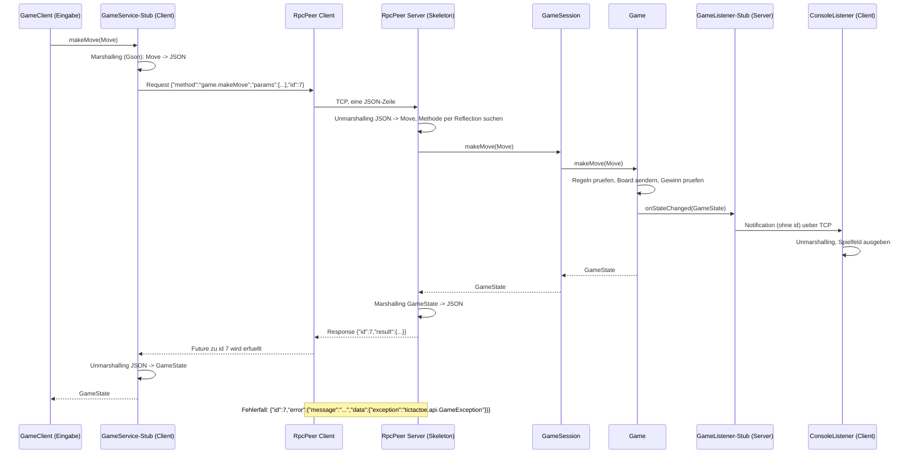
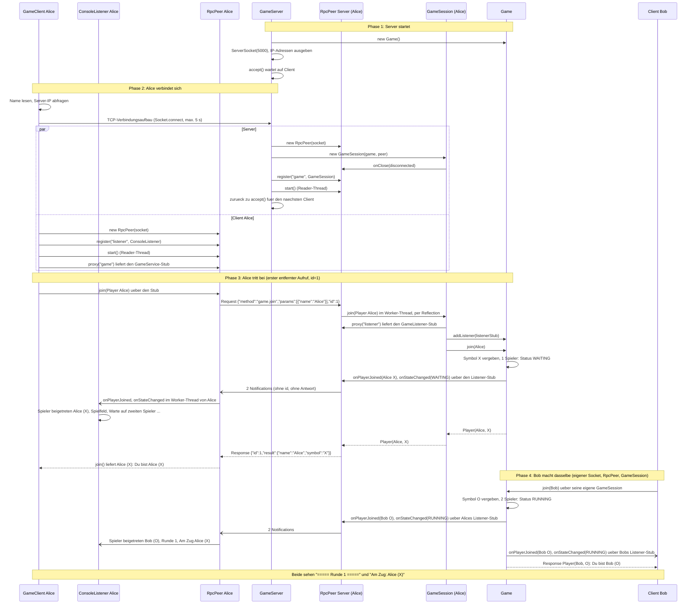

# Tic-Tac-Toe mit JSON-RPC (AI-VSP Praktikum 1, WiSe 2026/27)

Java 25 (LTS), Maven, Gson. Das Projekt entsteht in zwei Phasen (siehe Git-Tags):

| Tag | Inhalt |
|---|---|
| `phase1-lokal` | Nicht verteilte Anwendung: alle Fachklassen, ein Prozess, kein Netzwerk |
| `phase2-verteilt` | Client-Server ueber JSON-RPC 2.0 / TCP, Thin Client, Callbacks Server -> Client |

---

## Phase 1: lokale Anwendung

Start in IntelliJ: Run-Konfiguration **Lokal (Phase 1)** oder `tictactoe.local.LocalMain`.
Zwei Spieler (Alice = X, Bob = O) spielen abwechselnd an einer Konsole. Eingabe: `zeile spalte`, z. B. `1 1` oder `11`.
`neu` startet die Runde neu bzw. nach Spielende eine neue Runde, `bench [anzahl]` misst die Dauer eines lokalen
Aufrufs (siehe Liefergegenstand 6), `q` beendet.

| Paket | Klasse | Rolle |
|---|---|---|
| `model` | `Player`, `Move`, `GameState`, `Board`, `Symbol`, `Status` | Fachobjekte (in Phase 2 die DTOs) |
| `api` | `GameService` | Schnittstelle zum Spiel (in Phase 2 Contract Client -> Server) |
| `api` | `GameListener` | Observer-Schnittstelle (in Phase 2 Contract Server -> Client) |
| `api` | `GameException` | Fachlicher Fehler (ungueltiger Zug, nicht am Zug, ...) |
| `game` | `Game` | Spiellogik, Regeln, Gewinnpruefung, Observer-Subject |
| `ui` | `ConsoleListener` | Konsolenausgabe des Spielfelds (Observer) |
| `local` | `LocalMain` | Startklasse, liest Befehle von der Konsole |

Design Patterns: **Observer** (`GameListener`), **Command** (`Move`), **Facade** (`GameService`),
in Phase 2 zusaetzlich **Proxy** (Stubs).

---

## Phase 2: verteilte Anwendung

### Starten
In IntelliJ: zuerst **Server (Phase 2)**, dann **Client Alice (Phase 2)** und **Client Bob (Phase 2)**.
Fuer den Zeitvergleich (`bench`) statt dessen **Server (Benchmark)** starten: gleicher Server, aber ohne `-Drpc.verbose=true`.

Auf zwei Rechnern (z. B. ueber Hotspot oder Hamachi):
1. Server-Rechner: Port 5000 in der Windows-Firewall erlauben, **Server** starten.
   Der Server zeigt beim Start seine IPv4-Adressen an (bei Hamachi `25.x.x.x`).
2. Client-Rechner: **Client** starten und bei `Server-IP [Enter = localhost]:` die IP des Servers eingeben
   (optional `ip:port`). Bei einem Fehler wird mit Grund (abgelehnt, keine Antwort, Adresse unbekannt) erneut gefragt.

Ohne IntelliJ: `mvn package`, dann
```
java -Drpc.verbose=true -cp target/tictactoe-jsonrpc-1.0-jar-with-dependencies.jar tictactoe.server.GameServer 5000
java -cp target/tictactoe-jsonrpc-1.0-jar-with-dependencies.jar tictactoe.client.GameClient [host] [port] [name]
```
`host` ist nur die Vorgabe fuer die IP-Abfrage; ohne `name` fragt der Client nach dem Namen.
Fuer `bench` den Server ohne `-Drpc.verbose=true` starten.

Client-Befehle: `zeile spalte` (oder `11`), `neu` (auch `neustart`, `weiter`, `reset`), `bench [anzahl]` (Zeitvergleich, siehe 6.), `q`.

Der Server laeuft dauerhaft: Nach Spielende geht es mit `neu` weiter (Rundenzaehler im `GameState`).
Trennt sich ein Client (`q` oder Verbindungsabbruch), meldet der Server den Spieler ab (`Game.leave`),
die Runde endet und ein neuer Client kann den freien Platz uebernehmen. Doppelte Namen werden abgelehnt.

### Neue Klassen
| Paket | Klasse | Rolle |
|---|---|---|
| `rpc` | `RpcPeer` | JSON-RPC 2.0 ueber TCP, Stub-Erzeugung (`proxy`), Skeleton/Dispatcher (`handleRequest`), leerer Dienst `rpc.ping` fuer den Zeitvergleich |
| `rpc` | `RpcException` | Technische Fehler (Verbindung, Timeout, unbekannte Methode) |
| `server` | `GameServer`, `GameSession` | Socket-Server; pro Client eine Session, alle teilen ein `Game` |
| `client` | `GameClient` | Thin Client: Eingabe + Anzeige, keine Spiellogik |
| `client` | `Benchmark` | Zeitvergleich lokal vs. remote (Befehl `bench`, Liefergegenstand 6) |

---

## Liefergegenstaende

### 1. Nicht verteilte Anwendung
Tag `phase1-lokal`, Startklasse `LocalMain`. Sie enthaelt bereits alle Fachklassen der verteilten Version.

### 2. Designentscheidung C-S-Contract
```java
interface GameService  { Player join(Player); GameState makeMove(Move) throws GameException; GameState getState(); void reset(); }
interface GameListener { void onPlayerJoined(Player); void onPlayerLeft(Player); void onStateChanged(GameState); }   // Server -> Client
```
- **Bidirektional:** Client ruft `game.*`, Server ruft `listener.*` ueber denselben TCP-Socket zurueck.
- **DTOs:** Client -> Server `Player`, `Move` (enthaelt `Player`); Server -> Client `Player`, `GameState` (enthaelt `Board`, `Player`).
- **Thin Client:** Regeln, Zugreihenfolge und Gewinnpruefung liegen nur im Server, der Client zeigt an.
- **Alternativen:**
  - *Fat Client:* Client prueft Zuege vorab (spart Roundtrips), aber Regeln doppelt und Manipulation moeglich.
  - *Polling* statt Callback: einfacher, aber Verzoegerung und unnoetige Last.
  - *Delta-Updates* statt vollem `GameState`: weniger Daten, aber komplexer und fehleranfaellig.
  - *Java RMI:* weniger Code, aber binaeres Format, nicht menschenlesbar. *gRPC:* IDL + Protobuf, ebenfalls binaer.
- Eigene schlanke JSON-RPC-Schicht statt fertiger Bibliothek, damit Stub, Marshalling und Dispatch sichtbar sind. Gson uebernimmt das Marshalling.

Beispielnachricht (mit `-Drpc.verbose=true` sichtbar):
```
{"jsonrpc":"2.0","method":"game.makeMove","params":[{"player":{"name":"Alice","symbol":"X"},"row":1,"col":1}],"id":3}
```

### 3. Verteilung auf zwei Rechner
Siehe "Starten" oben.

### 4. Klassen mit Stubs
| Seite | Stub fuer | Implementierung auf der Gegenseite |
|---|---|---|
| Client | `GameService` (`peer.proxy("game", ...)`) | Server: `GameSession` -> `Game` |
| Server | `GameListener` (`peer.proxy("listener", ...)`) | Client: `ConsoleListener` |

`RpcPeer.handleRequest` ist auf beiden Seiten der generische Skeleton (Reflection).
DTOs brauchen keine Stubs, sie werden per Wert (als Kopie) uebertragen.
Nur fuer `bench`: Der Client erzeugt zusaetzlich einen Stub fuer `RpcPeer.Ping` (Dienst `rpc`, den jeder `RpcPeer` automatisch anbietet).

### 5. Sequenzdiagramm `makeMove`


#### Gesamtablauf: Serverstart, Verbindung und Beitritt
Ergaenzend zum Diagramm fuer `makeMove` zeigt dieses Diagramm den Ablauf vom Serverstart bis zum Spielbeginn.



**Erklaerung**
- **Phase 1:** Der Server erzeugt genau ein `Game`, das sich spaeter alle Clients teilen, und wartet mit `accept()` auf Verbindungen.
- **Phase 2:** Pro Verbindung entsteht auf beiden Seiten ein eigener `RpcPeer`, auf dem Server zusaetzlich eine `GameSession`
  als Dienst `game`. Server und Client richten ihre Seite gleichzeitig ein (`par`). Der Client registriert seinen
  `ConsoleListener` als Dienst `listener` schon vor dem `join`, weil der Server bereits waehrend des `join` zurueckruft.
- **Phase 3:** `join` ist ein entfernter Aufruf mit `id=1`. Erst in `GameSession.join` entsteht der Stub fuer den Rueckkanal
  und wird bei `Game` als Beobachter angemeldet. `Game` benachrichtigt ihn, noch bevor die Antwort zurueckgeht: Die Callbacks
  laufen als Notifications (ohne `id`, ohne Antwort) ueber denselben Socket. TCP haelt die Reihenfolge ein, also kommen erst
  die Notifications und dann die Response. Beim Client verarbeitet der Worker-Thread die Notifications im `ConsoleListener`,
  waehrend der Hauptthread noch auf die Antwort zu `id=1` wartet. Deshalb kann "Du bist Alice (X)" vor oder nach der
  Spielfeldausgabe erscheinen.
- **Phase 4:** Bob durchlaeuft dieselben Schritte mit eigenem Socket, `RpcPeer` und eigener `GameSession`. Mit dem zweiten
  Spieler wechselt der Status auf `RUNNING`, und `Game` benachrichtigt alle angemeldeten Listener-Stubs (Observer).
- **Bidirektional:** Client -> Server laufen Requests mit Antwort (`game.*`), Server -> Client Notifications ohne Antwort
  (`listener.*`), beides ueber dieselbe TCP-Verbindung.

### 6. Zeitvergleich lokal vs. remote
Im Client `bench` eingeben (Standard: 1000 Aufrufe je Messreihe, z. B. `bench 300` fuer weniger). Code: `tictactoe.client.Benchmark`.

Auch die lokale Version (**Lokal (Phase 1)**) kennt `bench`. Ohne Server misst sie den lokalen Aufruf auf dem laufenden
Spiel und zum Vergleich das Marshalling des `GameState` ohne Netz (den Teil eines Remote-Aufrufs, der sich lokal messen laesst).

**Vorgehen**
- Gemessen wird `getState()`: lokal auf einem `Game` im selben Prozess und remote ueber den Stub. Gleiche Schnittstelle
  `GameService`, gleicher Aufrufcode; der Unterschied ist nur der Transportweg.
- Vor jeder Messreihe ein Warm-up, damit der JIT-Compiler den Code optimiert hat. Danach wird jeder Aufruf einzeln mit
  `System.nanoTime()` gemessen.
- Ausgabe in Mikrosekunden pro Aufruf: **Minimum, Maximum, Mittelwert, Median**. Faktor und Aufschluesselung nutzen den
  Median, weil er robust gegen Ausreisser ist (Garbage Collection, WLAN).
- Fuer die Aufschluesselung misst `bench` zusaetzlich:
  - einen leeren RPC-Aufruf `rpc.ping`: gleicher Weg wie `getState()`, aber ohne Spiellogik und fast ohne Daten
    = Transport und RPC-Grundaufwand,
  - das Marshalling des `GameState` ohne Netz (Gson: Java -> JSON -> Java).

  `getState()` remote und `ping` werden abwechselnd gemessen, damit beide unter denselben Bedingungen laufen.
- **Wichtig:** Server mit **Server (Benchmark)** starten (ohne `-Drpc.verbose=true`), sonst wird seine Konsolenausgabe
  mitgemessen.

**Drei Szenarien** (zwei Laeufe; `bench` erkennt das Szenario selbst und nennt es in der Ausgabe)
1. **Lokal:** steckt in jedem Lauf (Zeile "Lokal"); alternativ in der lokalen Version `bench` eingeben.
2. **Remote ueber localhost:** Client auf dem Server-Rechner starten, `bench` eingeben.
3. **Remote ueber Netzwerk:** Client auf dem zweiten Rechner (Hotspot) starten, `bench` eingeben.
   Zum Vergleich in der Eingabeaufforderung `ping <server-ip>` ausfuehren (reine Netzlatenz).

**Ergebnisse** (Mikrosekunden pro Aufruf, nach eigener Messung eintragen)
| Szenario | Minimum | Maximum | Mittelwert | Median | Faktor (Median) |
|---|---|---|---|---|---|
| Lokal (im selben Prozess) | 0,01 us| 27,90 us| 0,36 us| 0,20 us| 1000 |
| Remote ueber localhost | 43,80 us| 435,10 us| 57,90 us| 51,80 us| 1000|
| Remote ueber Hotspot | | | | | |
| `ping` zum Server ueber Hotspot (nur Netz) | | | | - | - |

**Wofuer die Zeit draufgeht** (Aufschluesselung aus der Ausgabe von `bench`, Median)

Remote-Aufruf = Transport (TCP, Systemaufrufe, Thread-Wechsel Reader -> Worker -> wartender Aufrufer, Netzlatenz; gemessen per `ping`)
\+ Marshalling/Unmarshalling des `GameState` (Gson) + Spiellogik (= lokaler Aufruf) + Rest (Reflection, Messschwankung)

**Fazit**
- Die Spiellogik selbst ist fast vernachlaessigbar; nahezu die gesamte Remote-Zeit entfaellt auf Transport und Marshalling.
  Remote ist um Groessenordnungen langsamer als lokal: keine Leistungstransparenz (siehe 8.).
- Konsequenz fuer den Contract: wenige grobe Aufrufe (ganzer `GameState` statt vieler Einzelabfragen) und Callbacks statt Polling.

### 7. Uebertragung einer Exception
Belegtes Feld waehlen, ausserhalb des eigenen Zuges setzen oder `5 5` eingeben:
Server wirft `GameException` -> JSON-`error` mit Klassenname -> Client-Stub erzeugt `GameException` neu
(weil in der Signatur deklariert) -> Client faengt sie und zeigt "Server-Fehler (GameException): ...".
Nicht deklarierte Fehler, Verbindungsabbruch und Timeout (10 s) erscheinen als `RpcException`.

### 8. Transparenz
| Art | Erreicht? | Begruendung |
|---|---|---|
| Zugriffstransparenz | Ja | Aufruf ueber `GameService`, lokal `Game`, remote Stub; gleicher Aufrufcode (`bench` nutzt beides) |
| Ortstransparenz | Teilweise | Host/Port nur beim Verbindungsaufbau, danach unsichtbar; kein Namensdienst |
| Fehlertransparenz | Nein | Netzfehler werden als `RpcException` sichtbar, kein automatischer Reconnect (der Server gibt den Platz aber frei, ein Client kann neu beitreten) |
| Nebenlaeufigkeitstransparenz | Teilweise | `Game` ist `synchronized`, Callbacks werden serialisiert abgearbeitet |
| Leistungstransparenz | Nein | Remote-Aufrufe sind um Groessenordnungen langsamer |
| Migrations-/Replikationstransparenz | Nein | Ein Server, keine Replikation |
| Hinweis | | Parameter werden per Wert kopiert (DTOs), nicht per Referenz wie lokal |
