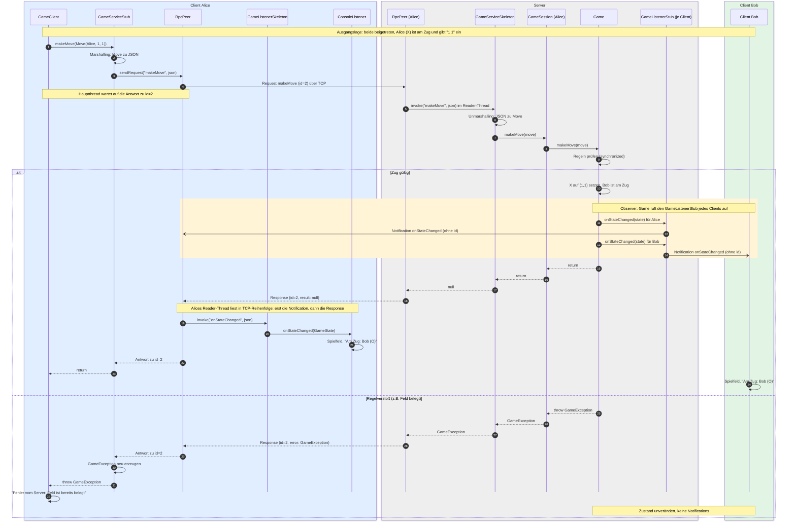
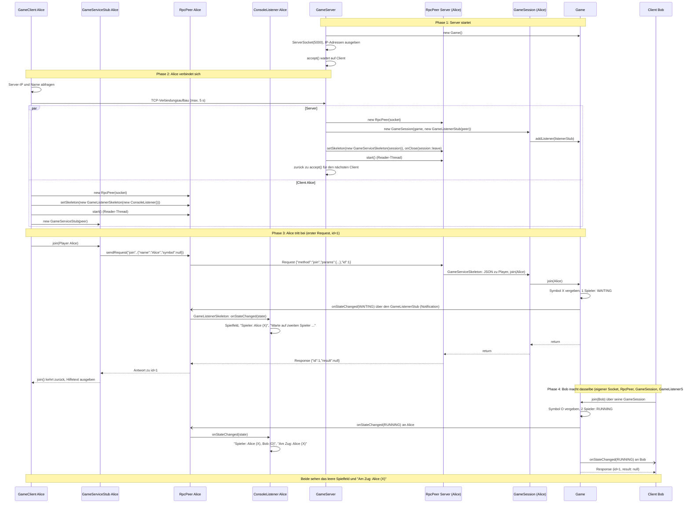
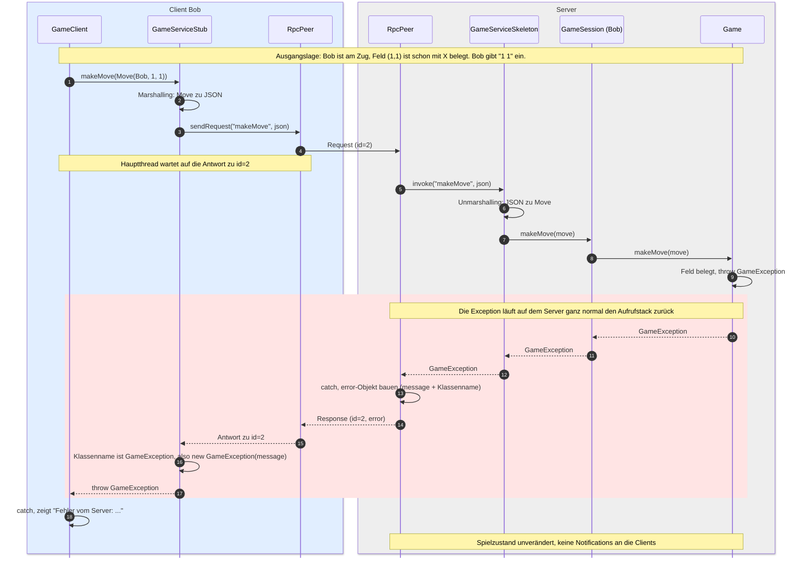

# Tic-Tac-Toe mit JSON-RPC (AI-VSP Praktikum 1, WiSe 2026/27)

Java 25 (LTS), Maven, Gson. Das Projekt entsteht in zwei Phasen (siehe Git-Tags):

| Tag | Inhalt |
|---|---|
| `phase1-lokal` | Nicht verteilte Anwendung: alle Fachklassen, ein Prozess, kein Netzwerk |
| `phase2-verteilt` | Client-Server über JSON-RPC 2.0 / TCP, Thin Client, Callbacks Server -> Client |

Der aktuelle Stand ist zusätzlich nach den Hinweisen zu Praktikum 2 vereinfacht (siehe nächster Abschnitt).

---

## Vereinfachter Client-Server-Contract (Hinweise zu Praktikum 2)

```java
interface GameService {                                   // Client -> Server: Requests mit id
    void join(Player player)  throws GameException;
    void makeMove(Move move)  throws GameException;
    void reset()              throws GameException;
}
interface GameListener {                                  // Server -> Client: Notifications ohne id
    void onStateChanged(GameState state);
}
```

| Hinweis des Profs | Vorher | Jetzt |
|---|---|---|
| 1. Höchstens ein Argument, keine mehrfachen Informationskanäle | Ein Beitritt kam dreifach an: Rückgabewert von `join` ("Du bist Alice (X)"), `onPlayerJoined` ("Spieler beigetreten: Alice (X)") und `onStateChanged`. Der Zustand nach einem Zug kam als Rückgabewert von `makeMove` und per `onStateChanged`, zusätzlich gab es `getState()`. | Jede Methode hat höchstens ein Argument. Der Spielzustand kommt nur noch über **einen** Kanal: `onStateChanged(GameState)`. Weil es nur ein Argument gibt, ist `params` in der JSON-Nachricht direkt dieses DTO. |
| 2. DTO-Redundanzen entfernen | `GameState` mit `winner` und Rundenzähler `round` | `winner` entfällt: Nach dem Gewinnzug wechselt das Zugrecht nicht, bei `WON` ist `current` der Gewinner. `round` entfällt. |
| 3. Rückgabewerte des `GameServerInterface` prüfen | `Player join(..)`, `GameState makeMove(..)`, `GameState getState()` | Alle Methoden `void`. Den neuen Zustand liefert der Callback. |
| 4. Argumente des `GameClientInterface` prüfen | `onPlayerJoined(Player)`, `onPlayerLeft(Player)`, `onStateChanged(GameState)` | Nur noch `onStateChanged(GameState)`: Observer-Pattern in der Push-Variante, ein Argument. `GameState.players` enthält die Spieler schon. |
| Stub/Skeleton von Anwendungsklassen trennen (wie im Eliza-JMS-Beispiel) | Stubs zur Laufzeit per dynamic Proxy und Reflection in `RpcPeer` erzeugt | Eigene Klassen im Paket `rpc`. Die Stubs implementieren dasselbe Interface wie die Anwendungsklassen (wie `ResponderProxy implements Function` bei Eliza). |

**Eine Regel für alle Nachrichten**
- **Client -> Server** ist immer ein **Request mit `id`**. Der Client wartet auf die Antwort: `"result":null` bei Erfolg oder
  `"error"` mit der `GameException`. Deshalb kommen Exceptions auch bei `void`-Methoden beim Client an.
- **Server -> Client** ist immer eine **Notification ohne `id`**. Der Server wartet bei Callbacks auf keine Bestätigung der
  Clients (fire-and-forget). So kann ein langsamer oder abgestürzter Client das gesperrte `Game` nicht blockieren.
  Die Spiellogik bleibt davon unberührt: Gespielt wird erst mit zwei Spielern, die Zugreihenfolge prüft `Game`.

**Zusätzlich entfernt:** Benchmark (`bench`) mit Ping-Dienst, Worker-Thread im `RpcPeer` (der Reader-Thread reicht,
weil kein Callback blockiert), Rundenüberschrift, Befehls-Synonyme (`neustart`, `exit`, ...), Port-Eingabe `ip:port` und
Wiederholungsschleife beim Verbinden.

---

## Phase 1: lokale Anwendung

Start in IntelliJ: Run-Konfiguration **Lokal (Phase 1)** oder `tictactoe.local.LocalMain`.
Zwei Spieler (Alice = X, Bob = O) spielen abwechselnd an einer Konsole. Eingabe: `zeile spalte`, z. B. `1 1` oder `11`.
`neu` startet eine neue Runde, `q` beendet.

| Paket | Klasse | Rolle |
|---|---|---|
| `model` | `Player`, `Move`, `GameState`, `Board`, `Symbol`, `Status` | Fachobjekte, unveränderlich (Records bzw. Enums); in Phase 2 die DTOs |
| `api` | `GameService` | Schnittstelle zum Spiel (in Phase 2 Contract Client -> Server) |
| `api` | `GameListener` | Observer-Schnittstelle (in Phase 2 Contract Server -> Client) |
| `api` | `GameException` | Fachlicher Fehler (ungültiger Zug, nicht am Zug, ...) |
| `game` | `Game` | Spiellogik, Regeln, Gewinnprüfung, Observer-Subject |
| `ui` | `ConsoleListener` | Konsolenausgabe des Spielfelds (Observer) |
| `ui` | `MoveInput` | Zug aus der Eingabe lesen, Hilfetext |
| `local` | `LocalMain` | Startklasse, liest Befehle von der Konsole |

Design Patterns: **Observer** (`GameListener`), **Command** (`Move`), **Facade** (`GameService`),
in Phase 2 zusätzlich **Proxy** (Stubs).

`LocalMain` meldet neben dem `ConsoleListener` einen zweiten Listener an, der sich den letzten Zustand merkt. So weiß die
Eingabeschleife, wer am Zug ist, ohne einen zweiten Informationskanal (`getState()`).

---

## Phase 2: verteilte Anwendung

### Starten
In IntelliJ: zuerst **Server (Phase 2)**, dann **Client Alice (Phase 2)** und **Client Bob (Phase 2)**.

Auf zwei Rechnern (z. B. über Hotspot oder Hamachi):
1. Server-Rechner: Port 5000 in der Windows-Firewall erlauben, **Server** starten.
   Der Server zeigt beim Start seine IPv4-Adressen an (bei Hamachi `25.x.x.x`).
2. Client-Rechner: **Client** starten und bei `Server-IP [Enter = localhost]:` die IP des Servers eingeben.
   Klappt die Verbindung nicht, meldet der Client den Grund und beendet sich.

Ohne IntelliJ: `mvn package`, dann
```
java -Drpc.verbose=true -cp target/tictactoe-jsonrpc-1.0-jar-with-dependencies.jar tictactoe.server.GameServer 5000
java -cp target/tictactoe-jsonrpc-1.0-jar-with-dependencies.jar tictactoe.client.GameClient [host] [port] [name]
```
`host` ist nur die Vorgabe für die IP-Abfrage; ohne `name` fragt der Client nach dem Namen.
Mit `-Drpc.verbose=true` zeigt der Server (bzw. Client) jede gesendete und empfangene JSON-Nachricht.

Client-Befehle: `zeile spalte` (oder `11`), `neu`, `q`.

Der Server läuft dauerhaft: Nach Spielende geht es mit `neu` weiter. Trennt sich ein Client (`q` oder
Verbindungsabbruch), meldet der Server den Spieler ab (`GameSession.leave` -> `Game.leave`), die Runde beginnt neu und
ein neuer Client kann den freien Platz übernehmen. Doppelte Namen und ein dritter Spieler werden abgelehnt.

### Neue Klassen
| Paket | Klasse | Seite | Rolle |
|---|---|---|---|
| `rpc` | `RpcPeer` | beide | Transport: JSON-RPC 2.0 über TCP, eine Nachricht pro Zeile, `sendRequest` / `sendNotification`, ein Reader-Thread |
| `rpc` | `Skeleton` | beide | Interface für die Empfangsseite: `invoke(method, param)` |
| `rpc` | `GameServiceStub` | Client | Stub, `implements GameService` |
| `rpc` | `GameServiceSkeleton` | Server | Skeleton, ruft die `GameSession` auf |
| `rpc` | `GameListenerStub` | Server | Stub, `implements GameListener` |
| `rpc` | `GameListenerSkeleton` | Client | Skeleton, ruft den `ConsoleListener` auf |
| `rpc` | `RpcException` | beide | Technische Fehler (Verbindung, Timeout, unbekannte Methode) |
| `server` | `GameServer` | Server | Socket-Server, verdrahtet pro Verbindung Peer, Stub, Session und Skeleton |
| `server` | `GameSession` | Server | Anwendungsklasse pro Client: leitet an das gemeinsame `Game` weiter, meldet beim Verbindungsende ab |
| `client` | `GameClient` | Client | Thin Client: Eingabe + Anzeige, keine Spiellogik |

Alles im Paket `rpc` ist Kommunikation, alles andere ist Anwendung. Die Anwendungsklassen kennen nur die Interfaces
`GameService` und `GameListener` und merken nicht, ob dahinter ein Stub oder das echte Objekt steckt.

```
Client                                                           Server
GameClient      --> GameServiceStub      --+                     +--> GameServiceSkeleton --> GameSession --> Game
                                           RpcPeer ==TCP== RpcPeer                                            |
ConsoleListener <-- GameListenerSkeleton <-+                     +--- GameListenerStub <----------------------+
```

---

## Liefergegenstände

### 1. Nicht verteilte Anwendung
Startklasse `LocalMain`. Sie enthält bereits alle Fachklassen der verteilten Version.

### 2. Designentscheidung C-S-Contract
Contract siehe oben ("Vereinfachter Client-Server-Contract").
- **Bidirektional:** Der Client ruft `GameService`, der Server ruft `GameListener` zurück, beides über denselben TCP-Socket.
- **DTOs:** Client -> Server `Player` (bei `join`) und `Move` (enthält `Player`); Server -> Client `GameState` (enthält
  `Board` und `Player`). `Player` wird also in beide Richtungen übertragen.
- **Ein Argument pro Methode:** `params` ist direkt das DTO, z. B. `"params":{"player":{...},"row":1,"col":1}`.
- **Unveränderliche DTOs:** `Player`, `Move`, `GameState` und `Board` sind Java-Records (alle Felder `final`, keine Setter,
  Listen unveränderbar). Gründe:
  - Ein DTO wird als Kopie übertragen; eine Änderung auf einer Seite hätte auf der anderen keine Wirkung. Ohne Setter
    ist das auch im Code klar.
  - Unveränderliche Objekte können ohne Synchronisation zwischen Threads geteilt werden.
  - Gson erzeugt Records über ihren Konstruktor. `Board` prüft dabei die Größe (3x3), ein fehlerhaftes Spielfeld aus dem
    Netz wird abgelehnt.
- **Thin Client:** Regeln, Zugreihenfolge und Gewinnprüfung liegen nur im Server, der Client zeigt an.
- **Alternativen:**
  - *Fat Client:* Client prüft Züge vorab (spart Roundtrips), aber Regeln doppelt und Manipulation möglich.
  - *Pull-Observer:* `update()` ohne Daten, der Client holt sich den Zustand mit `getState()`. Entspricht dem klassischen
    Observer-Pattern, braucht aber einen zusätzlichen Roundtrip, und der Callback müsste selbst einen entfernten Aufruf
    machen (dafür wäre wieder ein eigener Worker-Thread nötig, sonst Deadlock im Reader-Thread).
  - *Polling* statt Callback: einfacher, aber Verzögerung und unnötige Last.
  - *Delta-Updates* statt vollem `GameState`: weniger Daten, aber komplexer und fehleranfällig.
  - *Java RMI:* weniger Code, aber binäres Format, nicht menschenlesbar. *gRPC:* IDL + Protobuf, ebenfalls binär.
- Eigene schlanke JSON-RPC-Schicht statt fertiger Bibliothek, damit Stub, Skeleton, Marshalling und Transport sichtbar
  sind. Gson übernimmt das Marshalling.

### 3. Verteilung auf zwei Rechner
Siehe "Starten" oben.

### 4. Klassen mit Stubs
| Seite | Stub (implementiert das Interface, sendet) | Skeleton (empfängt, ruft die echte Implementierung) |
|---|---|---|
| Client | `GameServiceStub implements GameService` | `GameListenerSkeleton` -> `ConsoleListener` |
| Server | `GameListenerStub implements GameListener` | `GameServiceSkeleton` -> `GameSession` -> `Game` |

`RpcPeer` ist auf beiden Seiten nur der Transport. DTOs brauchen keine Stubs, sie werden per Wert (als Kopie) übertragen.

### 5. Sequenzdiagramm `makeMove`


**Nachrichten auf dem Netz** (je eine JSON-Zeile über TCP, Nummern = Schritte im Diagramm)
```
(4)      Alice -> Server   {"jsonrpc":"2.0","method":"makeMove","params":{"player":{"name":"Alice","symbol":null},"row":1,"col":1},"id":2}
(12,14)  Server -> beide   {"jsonrpc":"2.0","method":"onStateChanged","params":{"board":{"cells":[...]},"players":[...],"current":"O","status":"RUNNING"}}
(18)     Server -> Alice   {"jsonrpc":"2.0","id":2,"result":null}
(28)     Server -> Alice   {"jsonrpc":"2.0","id":2,"error":{"code":-32000,"message":"Feld ist bereits belegt","data":{"exception":"tictactoe.api.GameException"}}}
```

**Erklärung**
- **1-4 Client-Stub:** Alices Hauptthread ruft `makeMove` auf dem `GameServiceStub` auf, als wäre es das echte Spiel.
  Der Stub wandelt den `Move` mit Gson in JSON um (Marshalling) und übergibt ihn dem `RpcPeer`. Der vergibt `id=2`
  (der `join` hatte `id=1`) und schickt den Request. Danach wartet der Hauptthread auf die Antwort zu dieser `id`.
- **5-9 Skeleton und Spiellogik:** Auf dem Server gibt der Reader-Thread den Aufruf an den `GameServiceSkeleton`. Der
  wandelt das JSON zurück in einen `Move` (Unmarshalling) und ruft die `GameSession` von Alice auf, die an das gemeinsame
  `Game` weitergibt. `Game` prüft die Regeln (`synchronized`, weil die Reader-Threads mehrerer Clients zugreifen).
- **10-14 Callbacks:** Nach dem Zug ruft `Game` alle angemeldeten Listener auf (Observer). Auf dem Server sind das die
  `GameListenerStub`s, einer pro Client. Sie schicken den Zustand als Notification ohne `id`, `Game` wartet also nicht auf
  die Clients. Bob bekommt den neuen Zustand, obwohl er selbst nichts aufgerufen hat: Hier ruft der Server den Client auf.
- **15-18 Antwort:** Erst danach geht die Response mit `id=2` und `result: null` an Alice (`makeMove` ist `void`).
- **19-23 Anzeige:** Alices Reader-Thread liest die Nachrichten in TCP-Reihenfolge: Zuerst gibt er die Notification an den
  `GameListenerSkeleton`, der daraus einen `GameState` macht und den `ConsoleListener` aufruft. Danach weckt er mit der
  Response den wartenden Hauptthread. Bei Bob läuft die Anzeige genauso (24).
- **25-32 Fehlerfall:** Bei einem Regelverstoß wirft `Game` eine `GameException`. Der `RpcPeer` des Servers schickt sie als
  JSON-`error` mit dem Klassennamen. Der `GameServiceStub` erkennt die `GameException`, erzeugt sie neu und wirft sie;
  `GameClient` fängt sie und zeigt die Meldung. Der Zustand bleibt gleich, es gibt keine Notifications.

#### Gesamtablauf: Serverstart, Verbindung und Beitritt
Ergänzend zum Diagramm für `makeMove` zeigt dieses Diagramm den Ablauf vom Serverstart bis zum Spielbeginn.



**Erklärung**
- **Phase 1:** Der Server erzeugt genau ein `Game`, das sich später alle Clients teilen, und wartet mit `accept()` auf Verbindungen.
- **Phase 2:** Pro Verbindung entsteht auf beiden Seiten ein eigener `RpcPeer`. Auf dem Server kommen ein
  `GameListenerStub`, eine `GameSession` (meldet den Stub sofort als Listener an) und ein `GameServiceSkeleton` dazu. Der
  Client setzt seinen `GameListenerSkeleton` schon vor dem `join`, weil der Server bereits während des `join` zurückruft.
- **Phase 3:** `join` ist ein Request mit `id=1`. `Game` vergibt das Symbol und benachrichtigt die Listener, noch bevor die
  Antwort zurückgeht. TCP hält die Reihenfolge ein, also verarbeitet Alices Reader-Thread erst die Notification (Anzeige)
  und dann die Response. Die Ausgabe ist deshalb immer in derselben Reihenfolge, und der Beitritt erscheint nur einmal.
- **Phase 4:** Bob durchläuft dieselben Schritte mit eigenem Socket, `RpcPeer`, `GameSession` und `GameListenerStub`. Mit
  dem zweiten Spieler wechselt der Status auf `RUNNING`, und `Game` benachrichtigt alle Listener.
- **Bidirektional:** Client -> Server laufen Requests mit Antwort, Server -> Client Notifications ohne Antwort, beides über
  dieselbe TCP-Verbindung.

### 6. Zeitvergleich lokal vs. remote
Der Zeitvergleich (`bench`) wurde beim Vereinfachen entfernt. Code und Messergebnisse stehen in der Git-Historie
(Commit `9aa5649`, Klasse `tictactoe.client.Benchmark`).

### 7. Übertragung einer Exception
**Demo:** Server mit `-Drpc.verbose=true` starten. Alice setzt `1 1`, danach gibt Bob ebenfalls `1 1` ein
(alternativ: außerhalb des eigenen Zuges setzen oder `5 5` eingeben).

Kurz: `Game` wirft `GameException` -> der `RpcPeer` des Servers schickt ein JSON-`error` mit dem Klassennamen -> der
`GameServiceStub` erzeugt die `GameException` neu -> `GameClient` fängt sie und zeigt "Fehler vom Server: ...".



**Nachrichten auf dem Netz** (Nummern = Schritte im Diagramm)
```
(4)   Bob -> Server   {"jsonrpc":"2.0","method":"makeMove","params":{"player":{"name":"Bob","symbol":null},"row":1,"col":1},"id":2}
(14)  Server -> Bob   {"jsonrpc":"2.0","id":2,"error":{"code":-32000,"message":"Feld ist bereits belegt","data":{"exception":"tictactoe.api.GameException"}}}
```

**Erklärung**
- **1-4 Hinweg:** Wie bei jedem Aufruf: Der Stub wandelt den `Move` in JSON um und schickt einen Request mit `id=2`.
  Bobs Hauptthread wartet auf die Antwort zu dieser `id`.
- **5-9 Server:** Das Skeleton macht aus dem JSON wieder einen `Move` und ruft über die `GameSession` das `Game` auf.
  `Game` prüft die Regeln und wirft eine `GameException`, weil das Feld belegt ist.
- **10-13 Exception zurück:** Auf dem Server ist das eine normale Java-Exception, die von `Game` über `GameSession` und
  Skeleton bis in den `RpcPeer` zurückläuft. Ein Java-Objekt kann aber nicht direkt über das Netz. Deshalb fängt der
  `RpcPeer` sie und baut daraus ein JSON-`error` mit der Meldung und dem Klassennamen (`data.exception`).
- **14-15 Antwort:** Die Antwort trägt dieselbe `id=2`. Bobs Reader-Thread ordnet sie dem wartenden Hauptthread zu.
- **16-17 Stub:** Der Stub sieht `error` statt `result`. Weil der Klassenname `GameException` ist und `makeMove` sie im
  Interface deklariert (`throws GameException`), erzeugt er eine **neue** `GameException` mit derselben Meldung und wirft
  sie. Wie ein DTO wird die Exception also per Wert übertragen (als Kopie, nicht dasselbe Objekt).
- **18 Client:** `GameClient` fängt die Exception mit `catch (GameException e)`, genau wie bei einem lokalen Aufruf
  (Zugriffstransparenz). Das Spiel läuft weiter.

**Wo im Code**
| Schritt | Klasse und Methode |
|---|---|
| 9 | `Game.makeMove`: `throw new GameException("Feld ist bereits belegt")` |
| 13 | `RpcPeer.handleCall` fängt die Exception, `RpcPeer.error` baut das `error`-Objekt |
| 16-17 | `GameServiceStub.call` erzeugt die `GameException` neu und wirft sie |
| 18 | `GameClient.main`: `catch (GameException e)` |

**Wichtig**
- Das funktioniert auch bei `void`-Methoden, weil Aufrufe Client -> Server immer Requests mit `id` sind. Als Notification
  (ohne `id`) gäbe es keine Antwort, und die Exception ginge verloren.
- Andere Exceptions auf dem Server (z.B. `NullPointerException`) erzeugt der Stub nicht neu, sondern meldet sie als
  `RpcException` ("Fehler auf dem Server ..."). Verbindungsabbruch und Timeout (10 s) erscheinen ebenfalls als
  `RpcException`.

### 8. Transparenz
| Art | Erreicht? | Begründung |
|---|---|---|
| Zugriffstransparenz | Ja | `GameClient` ruft `GameService` auf, ohne zu wissen, dass es ein Stub ist; `ConsoleListener` wird lokal direkt und verteilt über das Skeleton aufgerufen |
| Ortstransparenz | Teilweise | Host/Port nur beim Verbindungsaufbau, danach unsichtbar; kein Namensdienst |
| Fehlertransparenz | Nein | Netzfehler werden als `RpcException` sichtbar, kein automatischer Reconnect (der Server gibt den Platz aber frei, ein Client kann neu beitreten) |
| Nebenläufigkeitstransparenz | Teilweise | Pro Client ein Reader-Thread auf dem Server; `Game` ist `synchronized`, Züge werden nacheinander ausgeführt |
| Leistungstransparenz | Nein | Ein entfernter Aufruf braucht einen Netzwerk-Roundtrip und ist um Größenordnungen langsamer als ein lokaler |
| Migrations-/Replikationstransparenz | Nein | Ein Server, keine Replikation |
| Hinweis | | Parameter werden per Wert kopiert (DTOs), nicht per Referenz wie lokal |
